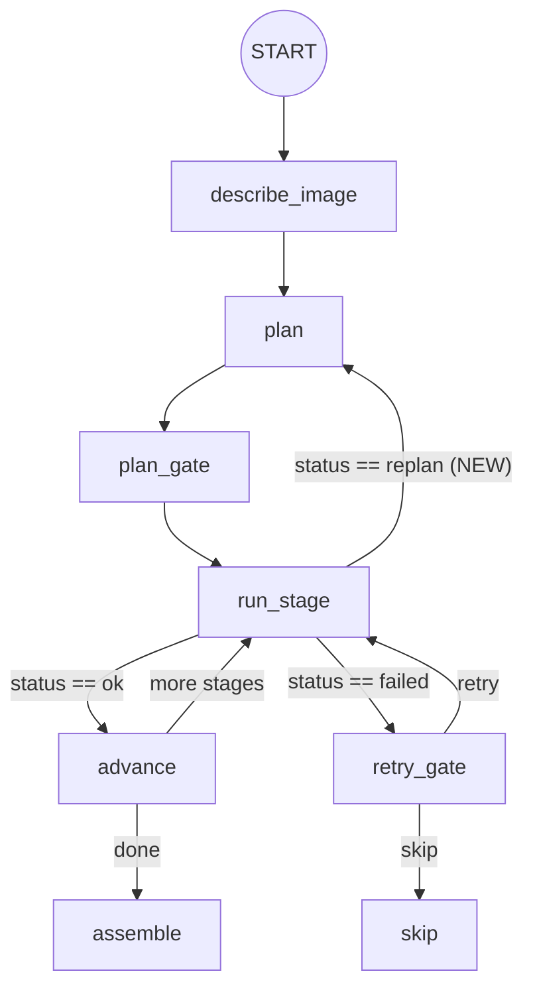

# Architecture & AI Engineering Review — `salome-agent`

**Branch**: `ngh/gemini-argon-reflexion`  
**Date**: 2026-10-17  
**Scope**: Full-stack developer & AI engineering critical audit of `salome_agent/`, `agent_server/`, `executor/` (`geom`, `shaper`, `smesh`), and `tests/`.

---

## 1. Executive Summary & Architectural Strengths

`salome-agent` is a sophisticated multi-agent CAD and meshing system built on **LangGraph** (`salome_agent/`) coupled over a local length-prefixed TCP protocol (`agent_server/`) to a live or headless **SALOME** process (`executor/`).

### 1.1 Key Architectural Strengths
Before detailing the problematic areas and improvements, several engineering choices in the repository stand out positively:

1. **Dual Representation (Live SALOME Study + Deterministic `BuildGraph` DAG)**:
   - Every tool call in `geom`, `shaper`, and `smesh` executes immediately against the live SALOME kernel *and* emits structured `CallRecord` entries stored in [`BuildGraph`](../../salome_agent/build_graph.py).
   - Dead-code elimination via [`_reachable`](../../salome_agent/codegen.py) ensures that abandoned intermediate shapes or exploratory queries do not pollute the final standalone `result.py` script.
2. **Incremental Multi-Turn Rollback & Pinning (`replay.py` & `amend.py`)**:
   - In multi-turn edits (`amend`), [`AmendSession`](../../salome_agent/specialists/amend.py) can remove or replace a node in the middle of the DAG and replay downstream nodes while pinning their original output variable names (`_pinned`), keeping downstream references intact.
3. **Domain-Specific LLM Guardrails**:
   - **Stream-level repetition loop detection** ([`RepetitionWatch`](../../salome_agent/repetition.py)) catches degenerate reasoning/content loops in real time before burning the full token/time budget.
   - **Reasoning token & wall-clock caps** (`ReasoningBudgetExceeded`, `ReasoningTimeExceeded` in [`salome_agent/llm.py`](../../salome_agent/llm.py)) prevent "overthinking" models from stalling tool loops.
   - **Geometric delta & validity feedback** ([`executor/geom/results.py`](../../executor/geom/results.py)) computes bounding-box, volume, and topology deltas after boolean/feature operations (`CheckShape`, no-op detection when a boolean cut or fuse leaves volume unchanged) so the model receives immediate geometric ground truth.
   - **Arithmetic offloading** ([`salome_agent/calc.py`](../../salome_agent/calc.py)) gives specialists a locked-down Python calculator for trigonometry and coordinate math instead of relying on error-prone token-by-token mental arithmetic.

### 1.2 Summary Matrix of Identified Issues

| ID | Category | Component / File | Severity | Status on `ngh/gemini-argon-reflexion` |
| :--- | :--- | :--- | :--- | :--- |
| **C-1** | Concurrency / Streaming | [`salome_agent/llm.py`](../../salome_agent/llm.py) (`_consume_stream`) | **Critical** | **Fixed & Tested** |
| **C-2** | Server Resilience / Timeouts | [`agent_server/backend.py`](../../agent_server/backend.py), [`agent_server/core.py`](../../agent_server/core.py) | **Critical** | **Fixed & Tested** |
| **C-3** | State Isolation | [`executor/geom/helpers.py`](../../executor/geom/helpers.py), [`executor/geom/__init__.py`](../../executor/geom/__init__.py) | **High** | **Fixed & Tested** |
| **S-1** | Process Safety & Sandboxing | [`salome_agent/calc.py`](../../salome_agent/calc.py) (`preexec_fn`, `RLIMIT_AS`) | **High** | **Fixed & Tested** |
| **S-2** | Path Confinement & Code Injection | [`executor/smesh/editing.py`](../../executor/smesh/editing.py) (`tool_export_mesh`) | **Medium** | **Fixed & Tested** |
| **P-1** | OS Portability | [`agent_server/handshake.py`](../../agent_server/handshake.py) (`_pid_start` / `/proc`) | **Medium** | **Fixed & Tested** |
| **CAD-1** | Study Lookup in Assembled Script | [`salome_agent/nodes/assembler.py`](../../salome_agent/nodes/assembler.py) (`_FIND_OBJECT`) | **High** | **Fixed & Tested** |
| **AI-1** | Agentic Control Flow (Replanning) | [`salome_agent/graph.py`](../../salome_agent/graph.py) (`_run_stage_node`) | **High** | **Fixed & Tested** |
| **AI-2** | Multimodal Bottleneck | [`salome_agent/graph.py`](../../salome_agent/graph.py), [`tool_specialist.py`](../../salome_agent/specialists/tool_specialist.py) | **High** | **Fixed & Tested** (opt-in policy) |
| **AI-3** | Context Window Management | [`salome_agent/specialists/tool_specialist.py`](../../salome_agent/specialists/tool_specialist.py), [`amend.py`](../../salome_agent/specialists/amend.py) | **Medium** | Strategic Recommendation |
| **AI-4** | Prompt Serialization Format | [`salome_agent/specialists/tool_specialist.py`](../../salome_agent/specialists/tool_specialist.py) (`str(dict)` vs JSON) | **Medium** | Strategic Recommendation |
| **AI-5** | Closed-Loop Visual Critic (VLM) | `salome_agent/verify/`, `agent_server/` | **Strategic** | Strategic Recommendation |
| **CAD-2** | Topological Naming Fragility | [`executor/geom/results.py`](../../executor/geom/results.py), [`executor/shaper/names.py`](../../executor/shaper/names.py) | **Strategic** | Strategic Recommendation |
| **CAD-3** | Cross-Module `GEOM` $\leftrightarrow$ `SHAPER` Bridge | [`salome_agent/graph.py`](../../salome_agent/graph.py) (`_cross_module`) | **Strategic** | Strategic Recommendation |

---

## 2. Concurrency, Streaming & Server Resilience

### 2.1 [C-1] SSE Stream Thread Explosion (`salome_agent/llm.py`)

#### Problem Analysis
In [`LLMClient._consume_stream`](../../salome_agent/llm.py), when an interactive cancellation token (`self.cancel: threading.Event`) was attached (e.g., from the GUI or CLI runner), the SSE reading loop previously read lines as follows:

```python
lines = resp.iter_lines(chunk_size=None, decode_unicode=True)
while (raw := self._wait_on(lambda: next(lines, _EOF))) is not _EOF:
    self._check_cancel()
    ...
```

Because `_wait_on(fn)` spawns a new `threading.Thread(target=run, daemon=True, name="llm-io")` on every invocation when `self.cancel is not None`, **every single SSE line (`data: ...` and empty separator lines) spawned a brand-new OS thread**.
- A single reasoning + tool-call response of 2,000 tokens typically emits **4,000 to 6,000 SSE lines**, resulting in **4,000–6,000 thread creations and teardowns per LLM call**.
- Over a 15-turn specialist loop, this created 50,000+ ephemeral threads, causing unnecessary GIL contention, context-switching overhead, and stack allocation churn.

#### Implemented Fix (`ngh/gemini-argon-reflexion`)
We introduced [`LLMClient._iter_lines`](../../salome_agent/llm.py) which uses **at most one daemon worker thread (`llm-stream`) for the entire SSE stream**, pulling one line at a time in lockstep via two `threading.Event`s (`want` and `got`):

```mermaid
sequenceDiagram
    participant Main as Main Thread (_consume_stream)
    participant Worker as Single Daemon Thread (llm-stream)
    participant Socket as resp.iter_lines()

    Main->>Worker: want.set()
    Worker->>Socket: next(lines, _EOF)
    loop Every _CANCEL_POLL (0.1s)
        Main->>Main: got.wait(0.1s) / check cancel.is_set()
    end
    Socket-->>Worker: SSE line
    Worker->>Main: box = (True, line); got.set()
    Main->>Main: _check_cancel() & process frame
```

- **Why lockstep on-demand pulling matters**: If the worker thread instead pumped lines freely into an unbounded `queue.Queue`, it would race ahead on buffered socket data or generator mocks, breaking deterministic mid-stream cancellation (such as [`test_cancel_mid_stream_stops_reading_and_closes_the_response`](../../tests/unit/test_llm.py)). Lockstep signaling preserves exact per-line cancellation semantics while reducing thread creation from $O(N_{\text{lines}})$ to $O(1)$ per stream.

---

### 2.2 [C-2] Unenforced Tool Timeouts & Missing Poisoning in Headless Mode (`agent_server/backend.py`, `agent_server/core.py`)

#### Problem Analysis
Two critical asymmetries existed between `GuiBackend` and `HeadlessBackend`, as well as between `geom` and `shaper`/`smesh`:

1. **No-op `HeadlessBackend.run_tool`**:
   In [`agent_server/backend.py`](../../agent_server/backend.py), `HeadlessBackend.run_tool(self, fn, timeout: float)` was implemented simply as:
   ```python
   def run_tool(self, fn, timeout: float):
       return fn()
   ```
   The `timeout` parameter (including `COMPUTE_TIMEOUT_S = 600` for SMESH `compute` and `TOOL_TIMEOUT = 120` for general tools) was **completely ignored** in headless mode. If Netgen 3D or an OpenCascade boolean/fillet operation hung in C++, the headless server blocked forever without ever setting `self._poisoned = True`.
2. **`geom` bypassed `run_tool` in `Core._dispatch`**:
   In [`agent_server/core.py`](../../agent_server/core.py):
   ```python
   r = call() if module == "geom" else b.run_tool(call, limit)
   ```
   This meant that:
   - In **GUI mode**, `geom` calls executed on the background TCP handler thread instead of being marshalled via `GuiBackend.run_tool` (`MainThreadInvoker`), even though `geom` tools can invoke `salome.ImportComponentGUI("GEOM")` (`_gui_call` in `executor/geom/helpers.py`) and mutate `salome.myStudy` concurrently with the Qt main thread!
   - In **Headless mode**, `geom` calls never had a timeout bound.

#### Implemented Fix (`ngh/gemini-argon-reflexion`)
1. [`HeadlessBackend.run_tool`](../../agent_server/backend.py) now runs `fn` inside a daemon watchdog thread with `t.join(timeout)`. If `t.is_alive()` after `timeout`, it latches `self._poisoned = True` and raises `TimeoutError(f"tool call exceeded {timeout}s")`, which [`Core.handle`](../../agent_server/core.py) turns into a clean fatal response (`_FATAL`) instructing the client to restart the poisoned server.
2. [`Core._dispatch`](../../agent_server/core.py) now routes all `call_tool` and `check_results` requests (`geom`, `shaper`, `smesh`) through `b.run_tool(call, limit)` whenever `b` provides `run_tool`.

---

### 2.3 [C-3] Module-Level Mutable State in GEOM (`executor/geom/helpers.py`)

#### Problem Analysis
In [`executor/geom/helpers.py`](../../executor/geom/helpers.py), auto-naming counters and replay name pins were stored in module-level globals:
```python
_counters: dict[str, int] = {}
_pinned: list[str] = []
```
While `executor/shaper/state.py` (`executor.__dict__["shaper_state"]`) and `executor/smesh/state.py` (`executor.__dict__["smesh_state"]`) properly encapsulated their state on the `executor` instance, `geom` relied on process-global state. Any concurrent or nested backend instances within the same Python process (e.g. in tests or multi-session environments) would corrupt each other's counters and pinned names.

#### Implemented Fix (`ngh/gemini-argon-reflexion`)
- `HeadlessBackend` and `GuiBackend` now initialize `self._counters: dict[str, int] = {}` and `self._pinned: list[str] = []` on the backend instance.
- [`executor/geom/helpers.py`](../../executor/geom/helpers.py) resolves `_executor_counters(executor)` and `_executor_pinned(executor)` from the `executor` instance first, while keeping module-level `_counters` and `_pinned` synchronized as a fallback for unit tests that pass bare `SimpleNamespace` mocks.

---

### 2.4 Single-Threaded TCP Server & Blocking Reads (`agent_server/server.py`)

#### Observation & Recommendation
[`agent_server/server.py`](../../agent_server/server.py) uses `socketserver.TCPServer` (single-threaded) where `_Handler.handle()` loops on `recv_msg(self.request)` until EOF.
- **Risk**: If a client crashes or hangs mid-connection without closing the TCP socket (or if a stray connection connects without sending a frame), `_read_exact` blocks indefinitely because no socket timeout (`self.request.settimeout(...)`) is configured on accepted connections, preventing any subsequent client from connecting.
- **Recommendation**: Enable `SO_KEEPALIVE` on accepted sockets or use `ThreadingTCPServer` coupled with a `threading.Lock` around `core.handle(req)` so that a stalled idle connection before `recv_msg` does not wedge the listener socket.

---

## 3. AI / Agentic Architecture & LLM Engineering

### 3.1 [AI-1] Stage-Level Replanning Loop (`salome_agent/graph.py`)

#### Problem Analysis
In [`salome_agent/graph.py`](../../salome_agent/graph.py), the initial workflow graph had two main loops:
1. **First turn (`plan` $\rightarrow$ `run_stage`)**: `_plan_node` decomposed the user prompt into a static list of stages (`plan: list[dict]`), and `_run_stage_node` executed each stage sequentially (`0 .. len(plan)-1`).
2. **Follow-up turns (`amend`)**: `_amend_node` could return `{"replan": reason}` to jump to `_plan_node` with `_replan_context`.

However, **during `run_stage`, if a specialist discovered that the Planner's stage decomposition was geometrically impossible** (for instance, the Planner split a self-intersecting profile or asked a later stage to fillet an edge that was consumed earlier), `_run_stage_node` only supported `"ok"` (`advance`) or `"failed"` (`retry_gate`). Retrying the exact same stage plan with the same stage boundaries repeatedly failed.

#### Implemented Fix (`ngh/gemini-argon-reflexion`)
We extended [`_run_stage_node`](../../salome_agent/graph.py) and [`route_after_run_stage`](../../salome_agent/graph.py) to support `"replan"` outcomes from specialists:
- When a specialist returns `{"replan": reason}`, `_run_stage_node` commits any already-completed stages (`status == "ok"`) to `build_graph`, constructs `replan_context` via `_replan_context(state, graph, result["replan"])`, marks the stage as `"replan"`, and routes directly back to `"plan"`.



---

### 3.2 [AI-2] Multimodal Information Bottleneck (`salome_agent/graph.py`, `tool_specialist.py`)

#### Problem Analysis
When the user provides reference images (`state["reference_images"]`), [`_describe_image_node`](../../salome_agent/graph.py) calls [`describe_images`](../../salome_agent/nodes/vision.py) to extract a structured JSON specification (`image_spec` with `parts`, `cuts`, `operations`) and immediately sets:
```python
update = {"image_spec": spec, "reference_images": None}
```
While stripping `reference_images` saves checkpoint memory and avoids sending base64 payloads to text-only specialist models, it creates a **lossy information bottleneck**:
- Complex 2D engineering drawings, fillets, chamfers, angular alignments, and relative proportions are frequently misread or underspecified by the single-shot `vision.py` JSON extraction.
- Once `reference_images` is erased, the downstream `geom` or `shaper` specialist is completely blind to the original drawing and cannot verify whether its 3D construction actually matches the visual reference.

#### Implemented Fix (`ngh/gemini-argon-reflexion`)
- Added support for `policy.pass_images_to_specialists` (default `False` for backward compatibility with text-only endpoints and unit test snapshots).
- When `policy.pass_images_to_specialists` is `True`, [`_describe_image_node`](../../salome_agent/graph.py) preserves `reference_images` in state, and [`_run_stage_node`](../../salome_agent/graph.py) forwards `reference_images` into [`ToolSpecialist.run`](../../salome_agent/specialists/tool_specialist.py), which attaches the images to the initial user message via `with_images(...)`.

---

### 3.3 [AI-3] Context Window Growth & Unbounded Tool History (`tool_specialist.py`, `amend.py`)

#### Problem Analysis
In [`ToolSpecialist._run`](../../salome_agent/specialists/tool_specialist.py) (`iteration_cap` up to 30+ turns) and [`run_amend`](../../salome_agent/specialists/amend.py):
- Every assistant turn and every tool response is appended to `messages` without pruning or summarization.
- Calls to `get_subshapes`, `measure`, `list_study_objects`, or `evaluate` can emit large payloads (hundreds of edge/face coordinates and IDs).
- By turn 20, the prompt tokens grow quadratically ($\sum_{t=1}^{T} |m_t|$), degrading LLM attention ("lost in the middle") and increasing latency and cost.
- Moreover, after a shape is modified or forgotten (`forget`), earlier `get_subshapes` or `measure` outputs in `messages` refer to **stale topological IDs or deleted shapes**, which frequently causes models to hallucinate outdated edge/face IDs in later tool calls.

#### Strategic Recommendation
Implement **sliding-window observation compaction** in `ToolSpecialist._run` and `run_amend`:
- Keep the full tool output for the last $K$ turns (e.g., $K = 6$).
- For older read-only inspection calls (`get_subshapes`, `measure`, `list_study_objects`, `check_shape`), replace the verbose tool message content with a compact 1-line summary (e.g., `"[archived measure output from turn 4 — call measure again if current dimensions are needed]"`), especially after any mutating tool call or `forget`.

---

### 3.4 [AI-4] Prompt Serialization: `str(dict)` vs Strict JSON (`tool_specialist.py`, `geom.py`, `shaper.py`)

#### Problem Analysis
Throughout [`salome_agent/specialists/tool_specialist.py`](../../salome_agent/specialists/tool_specialist.py), [`geom.py`](../../salome_agent/specialists/geom.py), and [`shaper.py`](../../salome_agent/specialists/shaper.py), structured data is formatted into LLM prompts using Python's `str()` (`repr()`):
- Line 180 of `tool_specialist.py`: `parts = [str(stage_plan)] + [b for b in blocks if b]`
- Line 306 of `tool_specialist.py`: `return str(result)`
- Line 210 of `geom.py`: `return "\n".join([f"ok: {', '.join(created)}"] + lines) if created else str(result)`

This sends Python dict syntax (`{'module': 'geom', 'ok': True, 'centre': [5, 5, 5]}` with single quotes and capitalized `True`/`False`/`None`) to the LLM while expecting strict RFC 8259 JSON (`{"dx": 10, "centered": true}`) back in tool call arguments.
- For smaller or open-weights models (Ollama / Gemma / Qwen / DeepSeek), seeing Python literals in `role: "tool"` and `role: "user"` messages increases the rate of malformed JSON tool calls (single quotes, `True`/`False` in JSON).
- *Note*: Existing unit tests ([`test_tool_specialist.py`](../../tests/unit/test_tool_specialist.py), [`test_specialist_geom.py`](../../tests/unit/test_specialist_geom.py), [`test_specialist_shaper.py`](../../tests/unit/test_specialist_shaper.py)) explicitly assert the single-quoted `str(dict)` representation, which is why we preserved it on `ngh/gemini-argon-reflexion` to avoid breaking test contracts.
- **Recommendation**: Migrate `render_result` and `stage_plan` formatting to `json.dumps(..., ensure_ascii=False)` and update the corresponding unit test assertions in a dedicated PR.

---

### 3.5 [AI-5] Closed-Loop Visual Self-Correction (VLM Critic)

#### Problem Analysis
Currently, verification at `finish_stage` ([`executor/geom/results.py`](../../executor/geom/results.py)) checks **topological and volumetric invariants**:
- Is the shape valid (`geompy.CheckShape`)?
- Is it a single connected solid (`len(solids) == 1`)?
- Did boolean operations change the volume/area as expected (`_delta_note`)?

However, topological validity does not guarantee **geometric/semantic correctness**:
- A hole drilled on the wrong face (`+X` instead of `+Y`), a bracket rotated $90^\circ$ the wrong way, or a fillet applied to the bottom edges instead of the top edges will pass `CheckShape` and `len(solids) == 1` with zero errors.
- Notably, the repository already has VTK/SALOME screenshot capabilities in `bench/CADSmith/render_views.py`!

#### Strategic Recommendation
Add an optional **Visual Critic (`verify_visual`)** step at `finish_stage` (or before `assemble`):
1. Render a 4-view composite image (`+X`, `+Y`, `+Z`, `isometric`) of the built shape in headless VTK or SALOME GUI.
2. Send the composite image + the user request (and reference image, if any) to the vision model (`llm.chat(..., module="vision")`).
3. If the VLM detects a gross orientation, placement, or feature mismatch, return a structured critique to the specialist before accepting `finish_stage`.

---

## 4. CAD & Meshing Engine Integration (`GEOM`, `SHAPER`, `SMESH`)

### 4.1 [CAD-1] Study Lookup Ambiguity in Generated Scripts (`salome_agent/nodes/assembler.py`)

#### Problem Analysis
When assembling `result.py` in [`salome_agent/nodes/assembler.py`](../../salome_agent/nodes/assembler.py), cross-stage / cross-module references emit a helper function `_FIND_OBJECT`:
```python
def find_object(name):
    def walk(sobj):
        it = salome.myStudy.NewChildIterator(sobj)
        while it.More():
            child = it.Value()
            if child.GetName() == name:
                return child.GetObject()
            ...
```
This implementation had two subtle bugs compared to the live server's `_find` / `study_objects` in [`agent_server/backend.py`](../../agent_server/backend.py):
1. **Deleted study objects leave empty labels behind**: In SALOME (`SALOMEDS`), removing an object from the study leaves its `SObject` label in the tree with empty attributes (`sobj.GetAllAttributes() == []`) and `sobj.GetObject() is None`. Walking the tree and returning the first `child.GetName() == name` without checking `GetAllAttributes()` can return `None` (raising `LookupError` even when a newer live object with the same name exists later in the tree!).
2. **Component priority**: If a mesh group or construction folder shares a name with a `GEOM` or `SHAPERSTUDY` shape, walking from `"0:1"` in arbitrary component order can return the wrong CORBA object.

#### Implemented Fix (`ngh/gemini-argon-reflexion`)
Updated [`_FIND_OBJECT`](../../salome_agent/nodes/assembler.py) to:
1. Query `salome.myStudy.FindObjectByName(name, comp)` across `("GEOM", "SHAPERSTUDY")` first, filtering out emptied labels (`not hasattr(s, "GetAllAttributes") or s.GetAllAttributes()`) and returning the newest match (`hits[-1].GetObject()`), matching [`executor/smesh/state.py`](../../executor/smesh/state.py)'s `_shaper_shape`.
2. Keep the recursive `walk(salome.myStudy.FindObjectID("0:1"))` (also guarded by `GetAllAttributes()`) as a fallback.

---

### 4.2 [CAD-2] Topological Naming & Subshape Selection Fragility (`executor/geom/results.py`, `executor/shaper/names.py`)

#### Problem Analysis
Both `GEOM` ([`_select_subshapes`](../../executor/geom/results.py)) and `SHAPER` ([`executor/shaper/names.py`](../../executor/shaper/names.py)) offer semantic selectors (`at`, `normal`, ` parallel`, `length`, `area`, `radius`, `limit`) to avoid raw OpenCascade subshape indices.
However:
1. **In `GEOM` (`tool_fillet_edges`, `tool_chamfer_edges`, `tool_make_thick_solid`)**:
   - The tools still accept raw integer subshape IDs (`edges: [4, 7, 12]`) discovered via `get_subshapes`.
   - In OpenCascade, integer subshape IDs (`SubShapeAllIDs`) are **not topologically persistent**: if `amend` modifies an upstream primitive (e.g., adding a hole or changing a boolean operand), `replay.py` replays `fillet_edges(shape, edges=[4, 7, 12])` with the old integer IDs, which now point to completely different edges!
2. **Tie-breaking on symmetric geometry in `SHAPER` (`names.py`)**:
   - When multiple faces or edges tie on `at` / `normal` / `area` without `limit` set, `names.py` either picks one or requires `limit`. On symmetric parts (e.g., 4 vertical edges of a box), models frequently omit `limit=4` when intending to fillet all 4 vertical edges, resulting in only 1 edge being filleted.

#### Strategic Recommendation
- Add semantic filter support (`at`, `normal`, `parallel`, `length`, `limit`) directly to `GEOM`'s `fillet_edges`, `chamfer_edges`, and `make_thick_solid` (just like `SMESH`'s `name_subshapes` already uses `_select_subshapes`), so `BuildGraph` records semantic selectors instead of brittle integer subshape IDs.
- In `SHAPER` (`names.py`), when `limit` is not specified and $N > 1$ subshapes tie within tolerance (`1e-3` mm) on all provided filters, emit a `note` in the tool response (`"note: 4 edges matched at equal distance; only 1 was selected — pass limit=4 if you meant all 4"`).

---

### 4.3 [CAD-3] Cross-Module `GEOM` $\leftrightarrow$ `SHAPER` Bridge (`salome_agent/graph.py`)

#### Problem Analysis
Currently, [`_cross_module`](../../salome_agent/graph.py) hard-refuses any multi-turn request that switches between `GEOM` and `SHAPER`:
```python
"The objects in the study (...) were built in SHAPER, and GEOM cannot use SHAPER objects."
```
In reality, SALOME's `SHAPERSTUDY` publishes standard `GEOM_Object` / `TopoDS_Shape` CORBA references when `model.publishToShaperStudy()` is called (which `SMESH` already consumes via `_shaper_shape(name)`!), and `SHAPER` can import `GEOM` study objects via `model.addImport(...)` or BRep exchange.
- **Recommendation**: Allow `GEOM` to bind published `SHAPERSTUDY` shapes into `executor.geom_bindings` via `find_object`, removing the hard refusal for `SHAPER` $\rightarrow$ `GEOM` follow-up turns.

---

## 5. Security, Sandboxing & Cross-Platform Portability

### 5.1 [S-1] `preexec_fn` & `RLIMIT_AS` Hazard in Multi-Threaded Python (`salome_agent/calc.py`)

#### Problem Analysis
[`salome_agent/calc.py`](../../salome_agent/calc.py) previously launched its sandboxed subprocess with:
```python
def _limit_memory():
    import resource
    resource.setrlimit(resource.RLIMIT_AS, (_MEMORY_BYTES, _MEMORY_BYTES))

proc = subprocess.run([sys.executable, "-I", "-c", _RUNNER], input=code,
                      capture_output=True, text=True, timeout=timeout,
                      preexec_fn=_limit_memory if sys.platform != "win32" else None)
```
This had two well-known systems pitfalls:
1. **`preexec_fn` in multi-threaded Python**: Python's official `subprocess` documentation warns that using `preexec_fn` in the presence of threads (which `salome-agent` uses for `llm-io` / `llm-stream`, `runner.drive`, and `pytest-xdist`) is unsafe because executing Python bytecode between `fork()` and `exec()` can deadlock on internal locks held by another thread at fork time.
2. **`RLIMIT_AS` before interpreter startup**: Setting a 512 MiB virtual address space limit (`RLIMIT_AS`) in `preexec_fn` *before* `execve(python)` runs can cause the dynamic linker (`ld.so`) or OpenBLAS/NumPy/SALOME-linked Python builds to fail at startup before `_RUNNER` even begins.

#### Implemented Fix (`ngh/gemini-argon-reflexion`)
Moved `resource.setrlimit(resource.RLIMIT_AS, ...)` directly inside the `_RUNNER` script (after `import ast, builtins, math, sys, traceback` and before compiling/executing user code) and removed `preexec_fn` from `subprocess.run`.

---

### 5.2 [S-2] Mesh Export Path Confinement & Identifier Validation (`executor/smesh/editing.py`)

#### Problem Analysis
In [`executor/smesh/editing.py`](../../executor/smesh/editing.py), `tool_export_mesh` built the file path and executed code via:
```python
path = os.path.join(run_dir, f"{m}.{fmt}")
run(state(executor), f"{m}.{_FORMATS[fmt].format(path=path)}")
```
Although `mesh_of(executor, m)` checks that `m` is a key in `state(executor).meshes`, validating that `m` is a valid Python identifier (`m.isidentifier()`) and verifying that `os.path.realpath(path)` stays confined inside `os.path.realpath(run_dir)` (`os.path.commonpath([real_dir, real_path]) == real_dir`) provides defense-in-depth against path traversal or code injection.

#### Implemented Fix (`ngh/gemini-argon-reflexion`)
Added `m.isidentifier()` and `os.path.realpath` / `os.path.commonpath` confinement checks in [`tool_export_mesh`](../../executor/smesh/editing.py).

---

### 5.3 [P-1] Linux `/proc` Coupling in Handshake (`agent_server/handshake.py`)

#### Problem Analysis
In [`agent_server/handshake.py`](../../agent_server/handshake.py), `live_owner()` checked whether the server PID recorded in `~/.salome_agent/server.json` was still running solely by reading `/proc/{pid}/stat`:
```python
def _pid_start(pid: int) -> int | None:
    try:
        with open(f"/proc/{pid}/stat") as f:
            return int(f.read().rsplit(")", 1)[1].split()[19])
    except (OSError, IndexError, ValueError):
        return None
```
On any POSIX environment where `/proc` is not mounted (e.g., macOS or restricted containers), `_pid_start(pid)` always returned `None`, causing `live_owner()` to conclude that the server was dead (`if live is None: return None`).

#### Implemented Fix (`ngh/gemini-argon-reflexion`)
Added `_pid_alive(pid)` using `os.kill(pid, 0)` as a fallback in `live_owner()` when `/proc` is not present (`not os.path.isdir("/proc")`), while preserving the exact `/proc/{pid}/stat` start-time verification on Linux.

---

## 6. Summary of Changes & Verification on `ngh/gemini-argon-reflexion`

### Modified Files
- [`salome_agent/llm.py`](../../salome_agent/llm.py): Added `_iter_lines` single-worker-thread stream iterator; replaced per-line `_wait_on` in `_consume_stream`.
- [`agent_server/backend.py`](../../agent_server/backend.py): Implemented watchdog timeout and `_poisoned = True` latching in `HeadlessBackend.run_tool`; added per-instance `_counters` and `_pinned`.
- [`agent_server/gui_backend.py`](../../agent_server/gui_backend.py): Added per-instance `_counters` and `_pinned`.
- [`agent_server/core.py`](../../agent_server/core.py): Routed all `call_tool` and `check_results` calls (including `geom`) through `b.run_tool` when present on the backend.
- [`executor/geom/helpers.py`](../../executor/geom/helpers.py) & [`executor/geom/__init__.py`](../../executor/geom/__init__.py): Scoped `_counters` and `_pinned` to the `executor` instance with module-level fallback for bare test mocks.
- [`salome_agent/calc.py`](../../salome_agent/calc.py): Moved `RLIMIT_AS` inside `_RUNNER` and removed `preexec_fn`.
- [`executor/smesh/editing.py`](../../executor/smesh/editing.py): Added identifier check and `os.path.realpath` confinement in `tool_export_mesh`.
- [`agent_server/handshake.py`](../../agent_server/handshake.py): Added `_pid_alive` (`os.kill(pid, 0)`) fallback when `/proc` is absent.
- [`salome_agent/nodes/assembler.py`](../../salome_agent/nodes/assembler.py): Improved `_FIND_OBJECT` to prioritize `GEOM`/`SHAPERSTUDY` and skip emptied study labels (`GetAllAttributes()`).
- [`salome_agent/graph.py`](../../salome_agent/graph.py) & [`salome_agent/specialists/tool_specialist.py`](../../salome_agent/specialists/tool_specialist.py): Added stage `"replan"` routing to `plan` with `replan_context` and opt-in `policy.pass_images_to_specialists` multimodal forwarding.
- **Unit Tests Added**:
  - [`tests/unit/test_llm.py`](../../tests/unit/test_llm.py): `test_cancellable_stream_uses_single_worker_thread`
  - [`tests/unit/test_backend.py`](../../tests/unit/test_backend.py): `test_run_tool_timeout_poisons_the_backend`, `test_counters_are_isolated_per_backend_instance`
  - [`tests/unit/test_assembler.py`](../../tests/unit/test_assembler.py): `test_find_object_prioritizes_shape_components_and_skips_removed`
  - [`tests/unit/test_graph.py`](../../tests/unit/test_graph.py): `test_run_stage_replan_routes_to_plan_with_context`, `test_pass_images_to_specialists_forwards_reference_images`

### Test Suite Results
```bash
PYTHONPATH=. ../salome-agent/venv/bin/pytest tests/unit -q
# 1200 passed, 1 skipped
```
